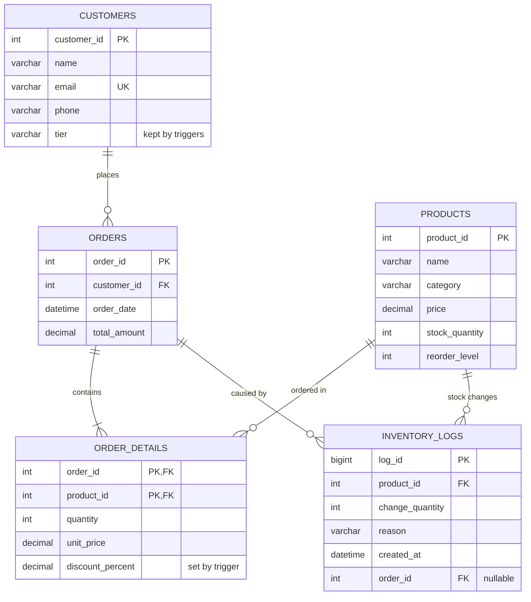

# Inventory and Order Management System

A MySQL database for an e-commerce company. It stores products, customers and
orders, keeps stock levels correct when orders are placed, records every stock
change for auditing, and provides reports on orders, low stock and customer
spending.

The project is a set of SQL scripts in [`sql/`](sql/). There is no application
code. You run the scripts in a MySQL client.

## Contents

- [What the system does](#what-the-system-does)
- [Requirements](#requirements)
- [How to run it](#how-to-run-it)
- [Database schema](#database-schema)
- [Scripts](#scripts)
- [Business rules](#business-rules)
- [Trying it out](#trying-it-out)
- [Notes and limitations](#notes-and-limitations)

## What the system does

| Phase | Goal | Where it is implemented |
| --- | --- | --- |
| 1. Schema | Tables, relationships and integrity rules | `01_database_schema.sql` |
| 2. Orders and inventory | Place multi-product orders, deduct stock, log every change | `02_create_triggers.sql`, `03_sample_data.sql`, `06_place_order_transaction.sql` |
| 3. Reporting | Order summaries, low-stock report, customer tiers, bulk discounts | `04`, `07`, `08`, `09` |
| 4. Replenishment and automation | Automatic stock, totals, discounts and tiers; restock low products | `05_automation.sql`, `10_stock_replenishment.sql` |
| 5. Views and performance | Order and low-stock views, indexes | `11_view_summary.sql`, `12_performance_optimization.sql` |

## Requirements

- MySQL 8.0.16 or newer. Earlier versions accept `CHECK` constraints but do not
  enforce them, which would let stock go negative.
- The `mysql` command-line client, or any client that understands `DELIMITER`
  (MySQL Workbench works).
- A user that can create databases, tables, triggers, functions and procedures.

## How to run it

The scripts depend on each other, and the file numbers are the run order:

| Step | Script | What it does |
| --- | --- | --- |
| 1 | `01_database_schema.sql` | Creates the database and the five tables |
| 2 | `02_create_triggers.sql` | Creates the stock-logging triggers |
| 3 | `03_sample_data.sql` | Inserts 15 products and 3 customers |
| 4 | `04_bulk_discounts.sql` | Creates `fn_bulk_discount()` |
| 5 | `05_automation.sql` | Creates the triggers that apply discounts, deduct stock, calculate totals and set customer tiers |
| 6 | `06_place_order_transaction.sql` | Places a sample order |
| 7 | `07`, `08`, `09` | Reports and the `vw_customer_spending` view |
| 8 | `10_stock_replenishment.sql` | Creates the `UpdateStock` and `ReplenishLowStock` procedures |
| 9 | `11_view_summary.sql` | Creates the `order_summary` and `low_stock_products` views |
| 10 | `12_performance_optimization.sql` | Creates indexes |

Ordering rules to keep in mind:

- **Triggers before sample data (02 before 03).** Otherwise the sample products
  are inserted without an "Initial stock" entry in the inventory log.
- **Discount function and automation before the sample order (04 and 05 before 06).**
  The order script only inserts rows. The discount, stock deduction, order
  total and customer tier all come from the triggers in script 05.

### Using the command line

Start an interactive session and load each script with `source`. This works the
same on Windows, macOS and Linux, and it keeps the selected database for
scripts that do not select one themselves.

```sql
mysql -u root -p

source sql/01_database_schema.sql;
source sql/02_create_triggers.sql;
source sql/03_sample_data.sql;
source sql/04_bulk_discounts.sql;
source sql/05_automation.sql;
source sql/06_place_order_transaction.sql;
source sql/07_order_summaries_per_customer.sql;
source sql/08_low_stock_report.sql;
source sql/09_customer_tiers_and_spending.sql;
source sql/10_stock_replenishment.sql;
source sql/11_view_summary.sql;
source sql/12_performance_optimization.sql;
```

### Starting over

Most scripts cannot be run twice. Triggers, procedures, views and indexes
already exist the second time. To reset,
drop the database and run everything again from step 1:

```sql
DROP DATABASE inventory_order_management;
```

## Database schema

Database name: `inventory_order_management` (InnoDB, defined in
`01_database_schema.sql`).

### Entity relationship diagram



### Tables

**`products`**

| Column | Type | Notes |
| --- | --- | --- |
| `product_id` | INT, PK, auto-increment | |
| `name` | VARCHAR(150) | Required |
| `category` | VARCHAR(100) | Required |
| `price` | DECIMAL(10,2) | Required, must be >= 0 |
| `stock_quantity` | INT | Default 0, must be >= 0 |
| `reorder_level` | INT | Default 10, must be >= 0 |

**`customers`**

| Column | Type | Notes |
| --- | --- | --- |
| `customer_id` | INT, PK, auto-increment | |
| `name` | VARCHAR(150) | Required |
| `email` | VARCHAR(255) | Required, unique |
| `phone` | VARCHAR(30) | Optional |
| `tier` | VARCHAR(20) | Default `No orders`. Kept up to date by triggers (script 05) |

**`orders`**

| Column | Type | Notes |
| --- | --- | --- |
| `order_id` | INT, PK, auto-increment | |
| `customer_id` | INT, FK to `customers` | Required |
| `order_date` | DATETIME | Defaults to the current time |
| `total_amount` | DECIMAL(12,2) | Default 0, must be >= 0 |

**`order_details`**: one row per product in an order.

| Column | Type | Notes |
| --- | --- | --- |
| `order_id` | INT, FK to `orders` | Part of the primary key |
| `product_id` | INT, FK to `products` | Part of the primary key |
| `quantity` | INT | Must be > 0 |
| `unit_price` | DECIMAL(10,2) | Price at the time of the order, must be >= 0 |
| `discount_percent` | DECIMAL(5,2) | Default 0.00. Set by a trigger from the quantity (script 05) |

**`inventory_logs`**: an audit trail of every stock change.

| Column | Type | Notes |
| --- | --- | --- |
| `log_id` | BIGINT, PK, auto-increment | |
| `product_id` | INT, FK to `products` | Product that changed |
| `change_quantity` | INT | Positive for stock added, negative for stock removed. Cannot be 0 |
| `reason` | VARCHAR(50) | For example `Initial stock`, `Order`, `Replenishment` |
| `created_at` | DATETIME | When the change happened |
| `order_id` | INT, FK to `orders` | Set when the change came from an order, otherwise NULL |

### Integrity rules

- Every order must belong to an existing customer.
- Every order line must point to an existing order and an existing product.
- Every log entry must point to an existing product, and to an existing order
  when `order_id` is set.
- All foreign keys use `ON UPDATE CASCADE` and `ON DELETE RESTRICT`. A customer,
  product or order cannot be deleted while other rows depend on it.
- `CHECK` constraints stop negative prices, stock, reorder levels and totals,
  zero or negative quantities, and zero-quantity log entries.
- Because `stock_quantity` cannot be negative, an order for more units than are
  in stock is rejected by the database.

## Scripts

### `01_database_schema.sql`
Creates the database and the five tables described above.

### `02_create_triggers.sql`
Two triggers keep the inventory log up to date automatically:

- `trg_products_after_insert`: when a product is added with stock above 0, logs
  the quantity with the reason `Initial stock`.
- `trg_products_after_update`: when `stock_quantity` changes, logs the
  difference (new minus old). The reason comes from the session variable
  `@log_reason` (default `Manual adjustment`) and the order from
  `@log_order_id`. A script sets these variables just before it changes stock.

### `03_sample_data.sql`
Inserts 15 grocery products with Kinyarwanda names across the categories
Ibiribwa (food), Imboga (vegetables), Imbuto (fruit), Ibinyobwa (drinks) and
Isuku (cleaning), plus three customers: Jean Claude, Alice Uwimana and Eric
Niyonzima.

### `04_bulk_discounts.sql`
Creates `fn_bulk_discount(qty)`. It ends with a report of every order line that
received a discount, which is empty until an order has a discounted line.

| Quantity of one product | Discount |
| --- | --- |
| 1 to 9 | 0% |
| 10 to 19 | 5% |
| 20 to 49 | 10% |
| 50 or more | 15% |

### `05_automation.sql`
Inserting a row into `order_details` is all that is needed to process a line.
The script creates:

- `trg_order_details_before_insert`: sets `discount_percent` from the quantity.
- `trg_order_details_after_insert`: deducts the stock (the products trigger from
  script 02 logs it as `Order`, linked to the order) and recalculates
  `orders.total_amount` from all lines. If there is not enough stock, the
  `CHECK` on `products.stock_quantity` fails and the whole insert is rejected.
- `fn_customer_tier(orders, total_spent)` and `sp_refresh_customer_tier(id)`:
  work out a customer's tier and store it in `customers.tier`.
- `trg_orders_after_insert` and `trg_orders_after_update`: refresh the tier when
  an order is created or its total changes.

### `06_place_order_transaction.sql`
Places an order inside one transaction. It only inserts rows; the triggers do
the rest:

1. Looks up the customer by email.
2. Creates the order and saves its ID.
3. Adds the order lines (soap x1, potatoes x2, eggs x1). Each product is read
   into variables first, because the trigger updates `products` and MySQL does
   not allow that in a statement that also reads `products`.
4. Commits, then shows the order summary (with the total calculated by the
   trigger), the ordered products with their new stock, and the matching log
   entries.

### `07_order_summaries_per_customer.sql`
Two queries: every order with its customer, number of item lines and total
units, and one summary row per customer (number of orders, first and last
order date, total spent, total units). Customers without orders do not appear.

### `08_low_stock_report.sql`
Report A lists products below their reorder level, with the shortage. Report B
lists all products with a status of `OUT OF STOCK`, `REORDER NOW` or `OK`,
sorted by urgency.

### `09_customer_tiers_and_spending.sql`
Creates the view `vw_customer_spending` with each customer's order count, total
spent, average order value, last order date and stored tier. Then it reports
every customer and a summary per tier.

| Tier | Total spent |
| --- | --- |
| Gold | 50,000 or more |
| Silver | 20,000 to 49,999 |
| Bronze | Under 20,000 |
| No orders | No orders yet |

### `10_stock_replenishment.sql`
Creates two procedures. Both log the change as `Replenishment`.

- `UpdateStock(product_id, quantity)`: adds the quantity to one product's stock.
  It rejects a quantity of 0 or less, and a product that does not exist.
- `ReplenishLowStock()`: finds every product below its reorder level, restocks
  it to twice its reorder level, and returns what was added.

### `11_view_summary.sql`
Creates two views:

- `order_summary`: order ID, customer name, order date, total amount and number
  of items.
- `low_stock_products`: products that are out of stock or below their reorder
  level.

### `12_performance_optimization.sql`
Creates indexes for the lookups and reports above: products by name and
category, orders by customer and date, order lines by order and by product, and
inventory logs by product, reason and date.

## Business rules

- **Order total:** calculated by a trigger as the sum of `quantity x unit_price x (1 - discount_percent / 100)`
  over the order's lines, rounded to 2 decimals.
- **Unit price:** copied from `products.price` when the line is added, so later
  price changes do not alter past orders.
- **Low stock:** a product is low when `stock_quantity < reorder_level`.
- **Customer tier:** stored in `customers.tier` and refreshed by triggers.
- **Inventory log:** every change to `stock_quantity` is logged by a trigger,
  with the reason and the order it came from when known.

## Trying it out

After running the scripts in order, the sample order for Alice has these effects:

- Order total: 600 + 2 x 1,000 + 5,000 = 6,600. No line reaches 10 units, so no
  discount applies.
- Stock: soap 100 to 99, potatoes 200 to 198, eggs 40 to 39.
- Inventory log: 15 `Initial stock` entries and 3 `Order` entries.
- Alice's tier is Bronze. Jean and Eric show as `No orders`.

No product is below its reorder level at first, so the low-stock reports are
empty. To see them work, lower a product's stock, then replenish it:

```sql
-- Drop coffee (reorder level 7) below its reorder level
UPDATE products SET stock_quantity = 5 WHERE name = 'Ikawa (250g)';

SELECT * FROM low_stock_products;

-- Restock every low product (logged as 'Replenishment')
CALL ReplenishLowStock();

-- Or restock one product
CALL UpdateStock(13, 50);

-- Full history for that product
SELECT * FROM inventory_logs WHERE product_id = 13 ORDER BY created_at;
```

To test bulk discounts, insert an order line of 10 or more units of one product.
The trigger sets the discount, so 20 units of one product gives 10% off that
line, and the order total and customer tier update on their own.

## Notes and limitations

- The triggers handle new order lines only. Updating or deleting a line does
  not change stock or the order total.
- Stock is deducted when a line is inserted, so an order for more than is in
  stock fails. Wrap an order in a transaction and roll back to undo it completely.
- Triggers pass the log reason to the products trigger through the session
  variables `@log_reason` and `@log_order_id`, and clear them afterwards.
